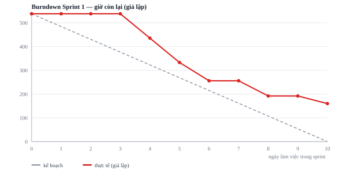

# Báo cáo tiến độ — Sprint 1

| | |
|---|---|
| **Iteration trên Project** | `Sprint 1` — [bảng công việc](https://github.com/users/nghiapt-1099/projects/1) |
| **Khoảng thời gian giả lập** | 2026-11-30 → 2026-12-11 (10 ngày làm việc) |
| **Iteration trước đó** | `Inc 0 — nền tảng`, 7 mục, 390,0 giờ, đã đóng hết |
| **Nguồn số liệu** | Đọc thẳng từ Project qua API (`work/sprint/gen-progress.py`) — không gõ lại bằng tay |

> **Sprint này là giả lập.** Dự án chưa khởi động; backlog được chia từ bộ thiết kế chi tiết
> đã có, còn kết quả sprint — mục nào xong, mục nào trượt, ngày xong — là kịch bản chọn theo
> thứ tự phụ thuộc kỹ thuật và theo hai câu hỏi khách đang thật sự treo. Sức chứa, ngày tháng
> và giờ của từng mục thì lấy từ kế hoạch nguồn, không bịa. Khung cuối §2 nói rõ chỗ nào là giả lập.

## 1. Trạng thái

| Trạng thái | Số issue | Tổng SWP | Tổng giờ | Ghi chú |
|---|---:|---:|---:|---|
| **Done** | 5 | 59 | 378,0 | Trong kịch bản: xong và đã đóng issue trên kho; lược đồ và API nền tảng xong trước hạn |
| **In Progress** | 2 | 13 | 83,5 | Trong kịch bản: còn dở sang Sprint 2; một mục đang chờ khách trả lời |
| **Todo** | 3 | 12 | 76,5 | Không bắt đầu được trong sprint — hai màn vì hết người (§2), một mục vì `CQ31` chưa có trả lời (§3) |
| **Tổng** | **10** | **84** | **538,0** | |

Sprint đặt **538,0 giờ**, chốt sổ còn **160,0 giờ** chưa xong — trong kịch bản
hoàn tất **378,0 giờ, tức 70 % khối lượng đặt ra**.

| Mục | SWP | Giờ | Trạng thái | Issue trên kho |
|---|---:|---:|---|---|
| [#31](https://github.com/nghiapt-1099/aidd-lab5-yuki-cold/issues/31) `BL-M1-181` — M1_DB — dựng lược đồ nhóm Dữ liệu chủ (phần 1/2) | 16 | 102,5 | **Done** | đã đóng |
| [#32](https://github.com/nghiapt-1099/aidd-lab5-yuki-cold/issues/32) `BL-M1-182` — M1_DB — dựng lược đồ nhóm Dữ liệu chủ (phần 2/2) | 16 | 102,5 | **Done** | đã đóng |
| [#137](https://github.com/nghiapt-1099/aidd-lab5-yuki-cold/issues/137) `BL-M9-050` — S1-01 — dựng màn theo spec mức B | 5 | 32,0 | **Done** | đã đóng |
| [#144](https://github.com/nghiapt-1099/aidd-lab5-yuki-cold/issues/144) `BL-M9-150` — M9 — dựng 2 API có spec riêng | 10 | 64,0 | **Done** | đã đóng |
| [#145](https://github.com/nghiapt-1099/aidd-lab5-yuki-cold/issues/145) `BL-M9-180` — M9_DB — dựng lược đồ nhóm Nền tảng · bảo mật | 12 | 77,0 | **Done** | đã đóng |
| [#19](https://github.com/nghiapt-1099/aidd-lab5-yuki-cold/issues/19) `BL-M1-002` — Làm rõ CQ31 — khả năng tiếp cận FEFO xếp hạng theo gì | 1 | 6,5 | **In Progress** | còn mở |
| [#28](https://github.com/nghiapt-1099/aidd-lab5-yuki-cold/issues/28) `BL-M1-150` — M1 — dựng 12 API có spec riêng (phần 1/2) | 12 | 77,0 | **In Progress** | còn mở |
| [#18](https://github.com/nghiapt-1099/aidd-lab5-yuki-cold/issues/18) `BL-M1-001` — Thêm cột fefo_access_rank vào bảng location | 4 | 25,5 | **Todo** | còn mở |
| [#20](https://github.com/nghiapt-1099/aidd-lab5-yuki-cold/issues/20) `BL-M1-050` — S1-03 — dựng màn theo spec mức B | 4 | 25,5 | **Todo** | còn mở |
| [#138](https://github.com/nghiapt-1099/aidd-lab5-yuki-cold/issues/138) `BL-M9-051` — S1-02 — dựng màn theo spec mức B | 4 | 25,5 | **Todo** | còn mở |

Mục `Done` đã **đóng issue trên kho**, không chỉ đổi trạng thái trên bảng — để người xem đối
chiếu được hai nơi. **`Done` ở đây là `Done` của kịch bản:** không dòng mã nào được viết, việc
đóng issue là một phần của giả lập.

## 2. Burndown

| Ngày | Kế hoạch còn lại | Thực tế còn lại | Lệch |
|---:|---:|---:|---:|
| 0 | 538,0 | 538,0 | +0,0 |
| 1 | 484,2 | 538,0 | +53,8 |
| 2 | 430,4 | 538,0 | +107,6 |
| 3 | 376,6 | 538,0 | +161,4 |
| 4 | 322,8 | 435,5 | +112,7 |
| 5 | 269,0 | 333,0 | +64,0 |
| 6 | 215,2 | 256,0 | +40,8 |
| 7 | 161,4 | 256,0 | +94,6 |
| 8 | 107,6 | 192,0 | +84,4 |
| 9 | 53,8 | 192,0 | +138,2 |
| 10 | 0,0 | 160,0 | +160,0 |

**Đường giả lập nằm trên đường kế hoạch ngay từ ngày 1 và không bao giờ xuống dưới.** Ba ngày
đầu không mục nào đóng được vì hai mục lược đồ `M1_DB` chạy song song, chỉ xong ở ngày 4 và
ngày 5; khoảng cách lớn nhất là ngày 3 (+161,4 giờ), gần kế hoạch nhất là ngày 6 (+40,8 giờ). Đó là hình dạng bình thường của một
sprint mở đầu bằng việc nền: khối lượng chỉ rơi khi cả mục xong, không rơi dần từng ngày.

Chỗ lệch đáng kể trong kịch bản nằm ở nửa sau. Mục `BL-M1-150` (12 API của M1, 77 giờ) **chỉ bắt đầu được từ
ngày 6**, sau khi lược đồ M1 xong; 5 ngày còn lại không đủ. Nó kéo theo hai màn `S1-02`,
`S1-03` không có người làm. Cuối sprint còn 160 giờ, bằng **30 %** khối lượng đặt ra.

**Bài học rút ngay cho Sprint 2:** sprint này nạp 95 % sức chứa, mà 282 trên 538 giờ là lược
đồ — tức hơn một nửa sprint là việc chặn mọi việc khác. Sprint 2 nạp tối đa 80 % và không xếp
quá một mục lược đồ lớn.

> Số ngày xong của từng mục là **đầu vào giả lập** (`work/sprint/plan.json`), không đọc được
> từ Project — bảng công việc chỉ giữ trạng thái hiện tại, không giữ mốc ngày của một sprint
> chưa từng chạy. Trạng thái, SWP và giờ trong báo cáo này thì đọc thẳng từ Project.

## 3. Rủi ro trễ

| Rủi ro | Issue | Ảnh hưởng tới mốc nào | Hành động | Ai làm, khi nào |
|---|---|---|---|---|
| **`CQ31` chưa có trả lời của khách.** Chưa biết `fefo_access_rank` xếp theo gì thì không viết được DDL; 14 mục khác đọc cột này | [#19](https://github.com/nghiapt-1099/aidd-lab5-yuki-cold/issues/19), [#18](https://github.com/nghiapt-1099/aidd-lab5-yuki-cold/issues/18) | Cổng `ACC-DATE-01` của Inc 3 (FEFO). Lệch ở Inc 1 còn vá được; để tới Inc 3 thì chạm cổng nghiệm thu | Gửi lại kèm **hai phương án mặc định** và hạn trả lời. Quá hạn thì chạy theo phương án A và ghi rõ là giả định phải xác nhận lại | BrSE, trước 2026-12-18 |
| **`CQ35` chạm 142 trên 172 mục.** Mã trạng thái cho lần gửi lại `Idempotency-Key` còn mở | [#146](https://github.com/nghiapt-1099/aidd-lab5-yuki-cold/issues/146) | Mọi increment. Chỉ chặn phần kiểm *mã trạng thái*; phần "không tạo bản ghi thứ hai" vẫn làm được | Tách mục kiểm mã trạng thái ra khỏi DoD của các mục ghi, gom thành một mục riêng chờ chốt | PL, trước khi Inc 2 bắt đầu |
| **Sprint nạp 95 % sức chứa** trong khi sprint đầu còn làm quen môi trường | cả Sprint 1 | Inc 1 (2026-11-30 → 2027-01-03) | Sprint 2 nạp tối đa 80 %; ba mục trượt đã nằm sẵn ở đầu hàng đợi | PL, khi lập Sprint 2 |
| **Epic `M10` chia còn thiếu mục** — chưa có mục nào cho script chuyển đổi, đối soát và chạy thử | epic [#6](https://github.com/nghiapt-1099/aidd-lab5-yuki-cold/issues/6) | `ACC-MIG-01` ở Inc 4, và **hai lần diễn tập migration** ở tuần 8 và tuần 15 | Thêm mục ở vòng chia kế tiếp, **trước** khi lập kế hoạch Inc 2 — diễn tập lần 1 nằm ở tuần 8 | PL, trước 2027-01-04 |
| **Hơn một nửa sprint là việc không nhìn thấy trên màn hình** (282/538 giờ là lược đồ) | [#31](https://github.com/nghiapt-1099/aidd-lab5-yuki-cold/issues/31), [#32](https://github.com/nghiapt-1099/aidd-lab5-yuki-cold/issues/32), [#145](https://github.com/nghiapt-1099/aidd-lab5-yuki-cold/issues/145) | Không chạm mốc nghiệm thu nào, nhưng chạm **niềm tin của khách** ở buổi demo cuối sprint | Demo bằng màn `S1-01` đã xong cộng truy vấn thật trên lược đồ mới; không demo bằng ảnh chụp thiết kế | BrSE, buổi demo 2026-12-11 |

## 4. Cách đọc báo cáo này

| Thứ | Nghĩa |
|---|---|
| `BL-{epic}-{nnn}` | Mã ổn định của mục trong backlog; số `#` là issue trên kho |
| SWP | Điểm khối lượng, Bề rộng × Độ khó tra ma trận — xem `estimate.md` §1 |
| Giờ | SWP × 6,4, làm tròn nửa giờ — quy ước ở `estimate.md` §3 |
| `CQ31`, `CQ35` | Câu hỏi đang chờ khách trả lời, liệt kê ở `task-breakdown.md` §4.7 |
| `ACC-DATE-01`, `ACC-MIG-01` | Cổng nghiệm thu của increment trong lịch tổng dự án |
| Inc 0 … Inc 4 | Năm increment của giai đoạn xây dựng; Sprint 1 là sprint đầu của Inc 1 |

**Trường `Est. hours` trên bảng công việc ghi cho cả mục cha lẫn mục con.** Mọi phép cộng từ
bảng phải lọc bỏ tầng cha trước, nếu không là đếm hai lần. Các số trong báo cáo này đã lọc.
